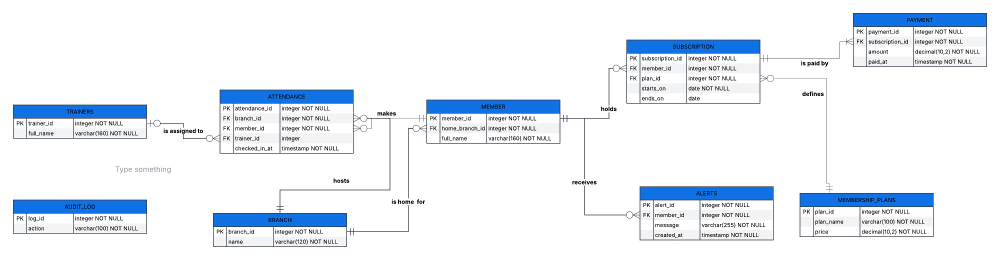

# Data Dictionary & Logical ERD

Phase II deliverable.Column meanings are derived from the source and from `normalization.md`.

Legend: **Req** = required (NOT NULL). **Uniq** = unique. **PK** = primary key. **FK** = foreign key.

---

## 1. ERD

---

## 2. Relationships, cardinality 

| # | Relationship | Cardinality | Optionality | Evidence in raw data |
|---|---|---|---|---|
| R1 | BRANCH → MEMBER | 1 : 0..N | MEMBER side **mandatory** | 40 branches; every member has a `gym_branch_id` |
| R2 | MEMBER → SUBSCRIPTION | 1 : 0..N | SUBSCRIPTION side **mandatory** | 17,500 members, 45,088 subscriptions, max 22 per member, 0 members without one |
| R3 | MEMBERSHIP_PLANS → SUBSCRIPTION | 1 : 0..N | **Mandatory** | every renewal has a `plan_type` |
| R4 | SUBSCRIPTION → PAYMENT | 1 : 1..N | **Mandatory** | 45,764 payment rows for 45,088 subscriptions; model permits retries |
| R5 | MEMBER → ATTENDANCE | 1 : 0..N | **Optional** | **1,763** members have zero visits |
| R6 | BRANCH → ATTENDANCE | 1 : 0..N | **Mandatory** | every visit has a `branch_id`; 5,223 visits are not at the home branch |
| R7 | TRAINERS → ATTENDANCE | 0..1 : 0..N | **Optional** | `trainer_id` is NULL on **96,099** of 108,744 rows |
| R8 | MEMBER → ALERTS | 1 : 0..N | **Optional** | runtime only |

**Many-to-many resolutions.** The source has no pure junction requirement, but two M:N relationships exist conceptually and are resolved by the associative table `ATTENDANCE`:

- **MEMBER ↔ TRAINERS** — a member trains with many trainers, a trainer coaches many members; `ATTENDANCE` carries both keys (populated only for Personal Training visits).
- **MEMBER ↔ BRANCH** — a member belongs to one home branch but may visit many; `ATTENDANCE.branch_id` records where each visit happened.

---

## 3. Tables

### 3.1 `MEMBER` — 17,500 rows

| Column | Meaning | Req | Uniq | Key |
|---|---|---|---|---|
| `member_id` | Gym membership number, e.g. `MBR-005003` | ✓ | ✓ | **PK** |
| `full_name` | Member's name as registered | ✓ | | |
| `gender` | Male / Female / Other | ✓ | | |
| `date_of_birth` | Date of birth; NULL for 540 members | | | |
| `occupation` | Declared occupation (7 values) | ✓ | | |
| `marital_status` | Single / Married / Other | ✓ | | |
| `membership_tier` | Current level: Basic / Standard / Premium / PT-Combo | ✓ | | |
| `join_date` | Date the member first registered | ✓ | | |
| `referral_source` | How they found the gym (6 values) | ✓ | | |
| `preferred_workout_time` | Usual training slot (5 values) | ✓ | | |
| `has_personal_trainer` | Y/N — whether a PT is assigned | ✓ | | |
| `primary_goal` | Stated fitness goal (6 values) | ✓ | | |
| `signup_channel` | App / Website / In-person | ✓ | | |
| `branch_id` | Home branch | ✓ | | **FK** → BRANCH |

### 3.2 `BRANCH` — 40 rows

| Column | Meaning | Req | Uniq | Key |
|---|---|---|---|---|
| `branch_id` | Branch code, e.g. `BR-033` | ✓ | ✓ | **PK** |
| `city` | City the branch is in (27 real cities after cleaning) | ✓ | | |
| `city_tier` | Tier1 / Tier2 / Tier3 — drives pricing | ✓ | | |
| `state` | Indian state (17 values) | ✓ | | |

> `city_tier` is not reliable in the source: **28 of 29 cities** contain conflicting values. Phase IV must resolve to the dominant value before loading.

### 3.3 `MEMBERSHIP_PLANS` — 4 rows (reference data)

| Column | Meaning | Req | Uniq | Key |
|---|---|---|---|---|
| `plan_id` | Plan code | ✓ | ✓ | **PK** |
| `billing_cycle` | Monthly / Quarterly / Half-Yearly / Annual | ✓ | ✓ | |
| `duration_days` | 30 / 91 / 182 / 365 | ✓ | | |
| `list_price` | Standard price. **Not in the source** — seeded in Phase IV | ✓ | | |

### 3.4 `SUBSCRIPTION` — 45,088 rows

| Column | Meaning | Req | Uniq | Key |
|---|---|---|---|---|
| `subscription_id` | From raw `renewal_id` | ✓ | ✓ | **PK** |
| `member_id` | Who holds it | ✓ | | **FK** → MEMBER |
| `plan_id` | Which plan was bought | ✓ | | **FK** → MEMBERSHIP_PLANS |
| `start_date` | First day covered | ✓ | | |
| `end_date` | Last day covered. **Stored, not derived** — 931 cycles differ from the plan duration | ✓ | | |
| `status` | Renewed / Lapsed / Auto-Renew Failed / Upgraded / Downgraded | ✓ | | |
| `days_before_expiry` | Days between renewal and the previous cycle's end; negative = renewed late (12,216 rows) | | | |
| `renewal_channel` | App / Front Desk / Phone Call from Staff | ✓ | | |
| `corporate_tie_up` | Y/N — billed through an employer | ✓ | | |

### 3.5 `PAYMENT` — 45,764 rows

| Column | Meaning | Req | Uniq | Key |
|---|---|---|---|---|
| `payment_id` | Surrogate key generated at load (the source has none) | ✓ | ✓ | **PK** |
| `subscription_id` | The subscription being paid for | ✓ | | **FK** → SUBSCRIPTION |
| `pay_date` | Date of payment. **Proxy** — the source has no payment date, so `start_date` is used | ✓ | | |
| `amount` | Amount received in INR | ✓ | | |
| `method` | UPI / Debit Card / Credit Card / Net Banking / Cash | ✓ | | |
| `discount_pct` | Discount applied, 0–40% | ✓ | | |

### 3.6 `TRAINERS` — 50 rows (reference data)

| Column | Meaning | Req | Uniq | Key |
|---|---|---|---|---|
| `trainer_id` | Trainer code, e.g. `TR-024` | ✓ | ✓ | **PK** |
| `full_name` | Trainer's name. **Not in the source** — seeded in Phase IV | ✓ | | |
| `specialty` | Main discipline. **Not in the source** — seeded in Phase IV | ✓ | | |

### 3.7 `ATTENDANCE` — 108,744 rows

| Column | Meaning | Req | Uniq | Key |
|---|---|---|---|---|
| `checkin_id` | Visit identifier | ✓ | ✓ | **PK** |
| `member_id` | Who visited | ✓ | | **FK** → MEMBER |
| `branch_id` | Where they visited | ✓ | | **FK** → BRANCH |
| `trainer_id` | Trainer for the session; NULL unless Personal Training (96,099 NULL) | | | **FK** → TRAINERS |
| `checkin_time` | Date and time of entry | ✓ | | |
| `checkout_time` | Date and time of exit; NULL when the member did not check out (13,144) | | | |
| `workout_type` | Cardio / Strength Training / Group Class / Personal Training Session | ✓ | | |
| `duration_minutes` | Workout length, 20–120. **Not** the check-out minus check-in (they disagree on 90% of rows) | ✓ | | |

### 3.8 `ALERTS` — runtime (empty at load)

| Column | Meaning | Req | Uniq | Key |
|---|---|---|---|---|
| `alert_id` | Surrogate key | ✓ | ✓ | **PK** |
| `member_id` | Member the alert is about | ✓ | | **FK** → MEMBER |
| `message` | Human-readable reminder text | ✓ | | |
| `created_at` | When the alert was generated | ✓ | | |

### 3.9 `AUDIT_LOG` — runtime (empty at load)

| Column | Meaning | Req | Uniq | Key |
|---|---|---|---|---|
| `log_id` | Surrogate key | ✓ | ✓ | **PK** |
| `table_name` | Which table changed | ✓ | | |
| `action` | INSERT / UPDATE / DELETE | ✓ | | |
| `changed_by` | Database user that made the change | ✓ | | |
| `changed_at` | When the change happened | ✓ | | |

---

## 4. Keys summary

| Table | Primary key | Foreign keys |
|---|---|---|
| MEMBER | `member_id` | `branch_id` → BRANCH |
| BRANCH | `branch_id` | — |
| MEMBERSHIP_PLANS | `plan_id` | — |
| SUBSCRIPTION | `subscription_id` | `member_id` → MEMBER, `plan_id` → MEMBERSHIP_PLANS |
| PAYMENT | `payment_id` | `subscription_id` → SUBSCRIPTION |
| TRAINERS | `trainer_id` | — |
| ATTENDANCE | `checkin_id` | `member_id` → MEMBER, `branch_id` → BRANCH, `trainer_id` → TRAINERS |
| ALERTS | `alert_id` | `member_id` → MEMBER |
| AUDIT_LOG | `log_id` | — (polymorphic via `table_name`) |

No composite primary keys survive normalisation: every table has a single-column key, and `ATTENDANCE` is the associative table that carries the two many-to-many relationships.

---

## 5. Business rules the schema must enforce in Phase IV

| Rule | Where | Source |
|---|---|---|
| A member cannot check in without an active subscription | `trg_block_expired_checkin` on ATTENDANCE | proposal §5 |
| Every change to payments and subscriptions is audited | `trg_audit_payments` on PAYMENT, SUBSCRIPTION | proposal §5 |
| Subscription end date must be after start date | CHECK on SUBSCRIPTION | 931 malformed cycles in raw |
| `discount_pct` between 0 and 100 | CHECK on PAYMENT | raw range 0–40 |
| `duration_minutes` between 1 and 240 | CHECK on ATTENDANCE | raw range 20–120 |
| `trainer_id` only set for Personal Training | CHECK on ATTENDANCE | 12,645 PT visits, all with a trainer |
| `member_status` is computed, never stored | `fn_is_active` | it is derived from `end_date`, so storing it would let it drift from the subscription history |
